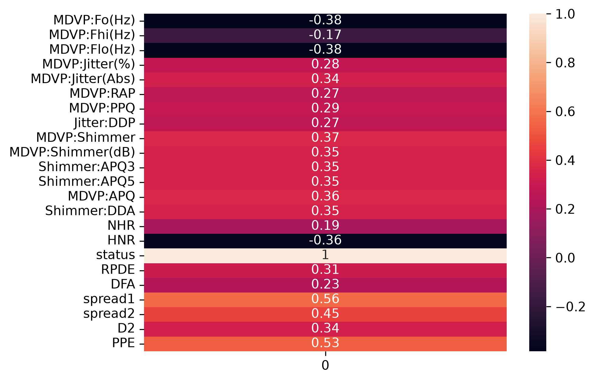
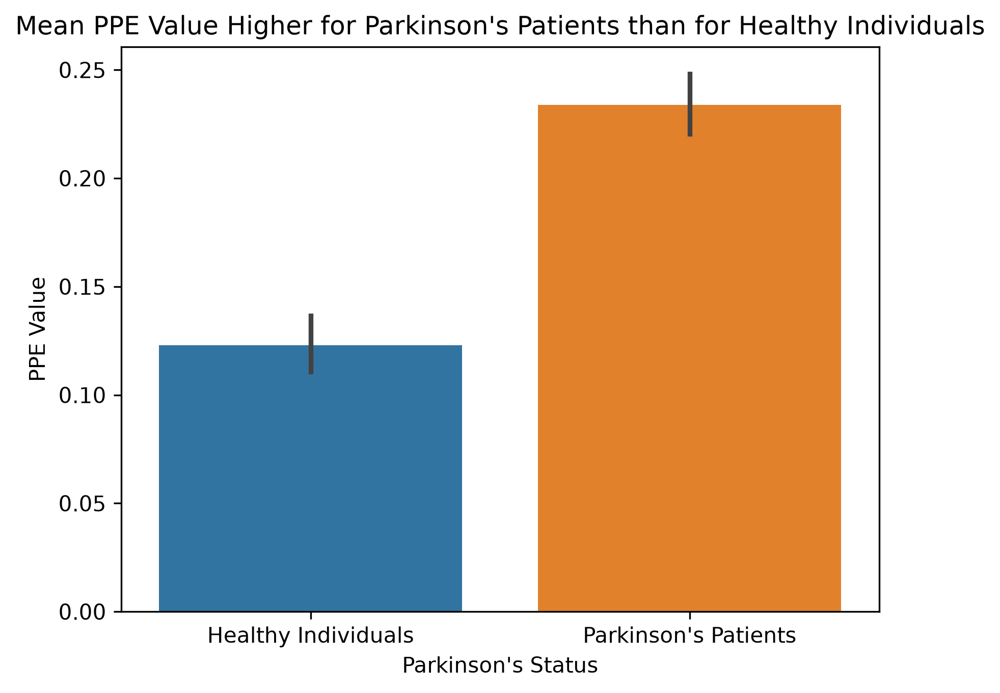
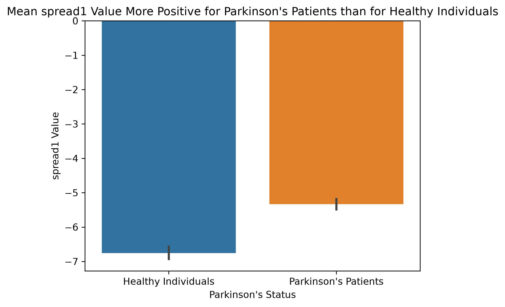
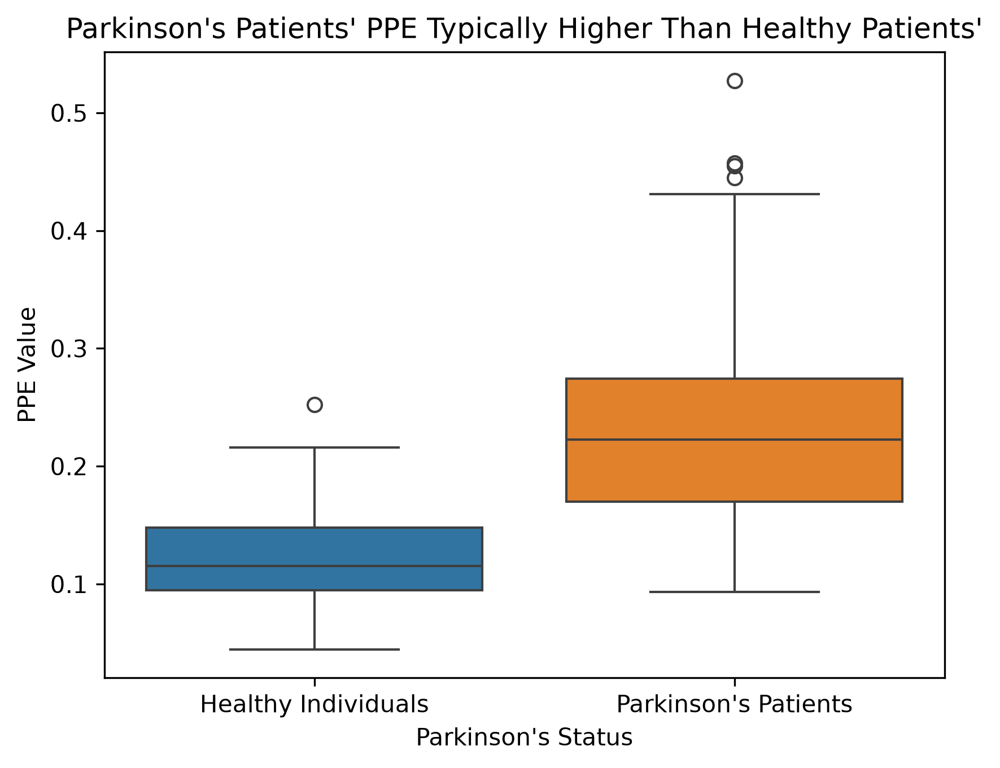
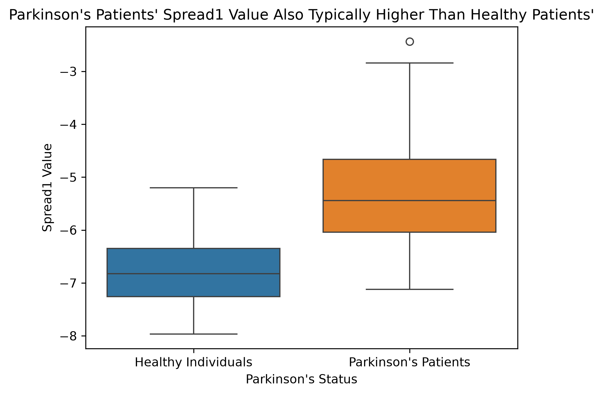

Do vocal biomarkers consistently distinguish Parkinson's patients from healthy individuals?
=

This project explores the possibility that vocal biomarkers can be used as an early screening tool for detecting whether a patient has Parkinson's disease. Using a dataset that recorded 23 different biomarkers in the speech of a large number of patients, we narrow in on a few features to see whether they are correlated with and able to predict the incidence of Parkinson's in a given group of patients. The dataset used, posted by Shreya Dutta on Kaggle.com, is available under a Open Data Commons Open Database License (ODbL) v1.0. It is cited in more detail in the References selection at the bottom of this file.

Cleaning Log:
=
The following bullet points describe work performed in subsequent cells.
- Dataset contains 1195 rows total with 24 columns.
- Dataset contained zero rows with missing values and zero duplicated rows.
- The first column, "name", is a patient ID number, which functions as a unique identifier and also anonymizes PII.
- All other columns are "float" dtypes, meaning they are decimal values and can have statistical analysis applied to them without needing conversion to another dtype first.
- The "status" column represents whether the patient is diagnosed with Parkinson's. Healthy individuals have "status"=0 and diagnosed patients have "status"=1
- However, there is a major issue: "status" should be a binary category (value = 0 or 1), but 1000 rows have unique non-binary decimal "status" values instead of 0 or 1
- There is no way to know the correct "status" values of those 1000 rows. Discussion on the dataset's Kaggle page points out this large error; response is "We will fix those errors in the next version, please stay connected."
- The difficult decision is made to exclude those 1000 rows to avoid introducing noise into the data. I will work with the remaining 195 rows instead and make note that the much smaller sample size limits any conclusions.

Exploratory analysis
=

The newly cleaned dataset should now function in terms of splitting the rows into two groups: Healthy individuals versus those with Parkinson's. I will take a look at the mean and median of the two groups, then see which columns correlate most strongly with patient status.

To address the stated research question, I will compare the rows with "status"=1 (Parkinson's patients) against rows with "status"=0 (healthy individuals). For that reason, I want to see which columns correlate most strongly with the "status" column.

Based on the above correlation diagram, I will examine the following two columns because they have the largest absolute r values:
- PPE (Pitch Period Entropy): This unitless variable represents how regular the pitch period was. Put another way, it represents whether a person takes an inconsistent amount of time to produce sounds.
- spread1: This variable (no unit specified) measured variation in voice frequency. That is, it represents how much a person's voice has inconsistent pitch.

Next, let us see an overview of how Parkinson's patients compare to healthy individuals on these two variables.

  

For the mean of both variables, Parkinson's patients score higher. This means that on average, Parkinson's patients have more varying vocal pitch and take more varied amounts of time to speak than healthy individuals. But the above charts only examine the means for each variable. Let us take a closer look at the range, quartiles, and medians of each variable and patient group.

  

For both of these variables, the means and interquartile ranges appear quite different for the two groups.

Comparative analysis
=

I will perform a t-test for each variable to determine whether the difference between healthy individuals and Parkinson's patients is statistically significant.

PPE t-test hypotheses and execution
-

The null hypothesis is that there is no significant difference in PPE between the two groups. 

The alternative hypothesis is that the mean PPE of Parkinson's patients is significantly higher than that of healthy individuals.

- Mean PPE value of healthy individuals: 0.123  
- Mean PPE value of Parkinson's patients: 0.234  
- Difference in mean PPE: 0.111  
- t-statistic: -11.670090179718107  
- p-value: 6.764318285836851e-23

Interpreting t-test results for PPE
-

The absolute value of the t-statistic, which compares the difference in means to the standard error, was very high, meaning that the difference in means far outstrips the amount of noise in the data. The p-value, which is the probability that a t-statistic this extreme would be the result of random chance, is very very low.

    

Healthy individuals had a mean PPE value of 0.123, whereas that of Parkinson's patients was 0.234. This 0.111 difference in mean PPE is statistically significant both because the p-value is low and the absolute value of the t-statistic is high, meaning that the means were very different and there is an extremely small likelihood of that difference resulting from random chance.
 

For this reason, I reject the null hypothesis in favor of the alternative hypothesis: There is a significant difference in PPE between Parkinson's patients and healthy individuals.

spread1 t-test hypotheses and execution
-

The null hypothesis is that there is no significant difference in spread1 values between the two groups. 

The alternative hypothesis is that the mean spread1 value of Parkinson's patients is significantly higher than that of healthy individuals.

- Mean spread1 value of healthy individuals: -6.759  
- Mean spread1 value of Parkinson's patients: -5.333  
- Difference in mean spread1: 1.426  
- t-statistic: -11.634674547436209  
- p-value: 1.769223693117403e-21

Interpreting t-test results for spread1
-

Bearing in mind the definitions of the t-statistic and p-value described in the previous test, I see that the absolute value of the t-statistic is again very high and the p-value is again extremely low.

Healthy individuals had a mean spread1 value of -6.759, whereas that of Parkinson's patients was -5.333, meaning the mean spread1 of Parkinson's patients was higher by a difference of 1.426. This difference is statistically significant both because of the very low p-value and the high absolute value of the t-statistic.

As a result, I again reject the null hypothesis in favor of the alternative hypothesis: There is a significant difference in spread1 between Parkinson's patients and healthy individuals.

Predicting future Parkinson's cases
=

Now that there is reason to believe that there is a relationship between patient status and the two variables of PPE and spread1, it is useful to see whether either variable can be used to predict given patient's Parkinson's status.

I will train a k-nearest neighbor (knn) model on each of the "PPE" and "spread1" columns to predict the health status of a given patient. To determine the model's accuracy, I will split the dataset into 70% training and 30% testing segments. I will train two separate models, one on each variable, train on the training segment, test on the testing segment, then score the models' accuracy in the testing segments.

kNN results for PPE
-

- kNN score on test segment = 0.8813559322033898

Above, I see that the knn model I trained on the training segment of PPE values was able to accurately predict a patient's Parkinson's status for approximately 88.136% of testing rows. Next, I will create another knn model using the spread1 column.

kNN results for spread1
-

- kNN score on test segment = 0.8813559322033898

The knn model trained on the spread1 training set also achieved an accuracy of 88.136% when used to predict the Parkinson's status of testing rows. The identical score seems a bit odd, so let us quickly check whether the prediction for each row was identical across the two models:

- Predictions identical: False

As odd as the coincidence may be, it appears that the two knn models did not predict the same "status" value for each row. That is, the first model may have gotten row A incorrect, while the second model predicted it correctly--but in total, both had the same ratio of successes to failures.

Conclusions and caution
=

Based on the two t-tests that were performed, there is most likely a strong correlation between "status" and "PPE", and between "status" and "spread1". While this can open the door for meaningful follow-up research, it must be stressed that correlation does not equal causation, so I cannot say with any certainty that Parkinson's disease causes high "PPE" values or high "spread1" values. For example, it is possible that both Parkinson's and PPE are downstream of a more fundamental, unidentified health issue, such that the two are often comorbid.

I was able to train a knn model for each of the two variables and both models performed on the test data with reasonable, though nowhere near airtight, accuracy. For that reason, the knn models are most useful as an initial exploratory tool for narrowing down large groups of patients into initial rows of interest, but not as a final decision-making tool.

Additionally, it must be noted that the rows I worked with were a very small subset of the original dataset because the overwhelming majority of rows had erroneous "status" values. This is particularly vexing because "status" was the target I was attempting to predict using the features of "PPE" and "spread1". As a result, care should be taken not to extrapolate from the results in this project; instead, this project should be used as a reason to correct the errors in the original dataset then run these analyses again. If a strong pattern emerges at that point, it could then be possible that stronger conclusions could be drawn.

    

Ultimately, while I cannot claim causation, the analysis here nonetheless promises value in further investigating vocal biomarkers as an early detection tool for Parkinson's. 

References
=

The dataset used for this project is:  
Shreya Dutta. (2024). Parkinson's Disease [Dataset]. Kaggle. https://doi.org/10.34740/KAGGLE/DSV/9759604

I also consulted the pandas, seaborn, and SciPy User Guides, the websites Geeks for Geeks and LeafCoding, and various Stack Overflow posts:  
<i><a>https://pandas.pydata.org/docs/reference/api/pandas.DataFrame.mode.html</a>  
<a>https://pandas.pydata.org/pandas-docs/stable/reference/api/pandas.DataFrame.isin.html</a>  
<a>https://seaborn.pydata.org/generated/seaborn.barplot.html</a>  
<a>https://docs.scipy.org/doc/scipy/reference/generated/scipy.stats.ttest_ind.html</a>  
<a>https://www.geeksforgeeks.org/python/get-unique-values-from-a-column-in-pandas-dataframe/</a>  
<a>https://www.geeksforgeeks.org/pandas/python-pandas-series-to_frame/</a>  
<a>https://www.leafcoding.com/seaborn/tick-labels</a>  
<a>https://stackoverflow.com/questions/70479605/python-pandas-pandas-correlation-one-column-vs-all</a></i>

